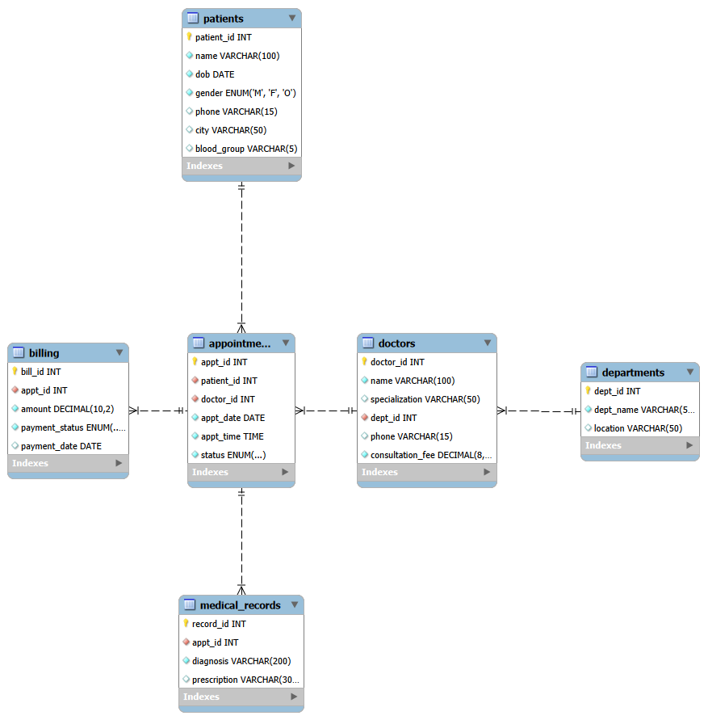
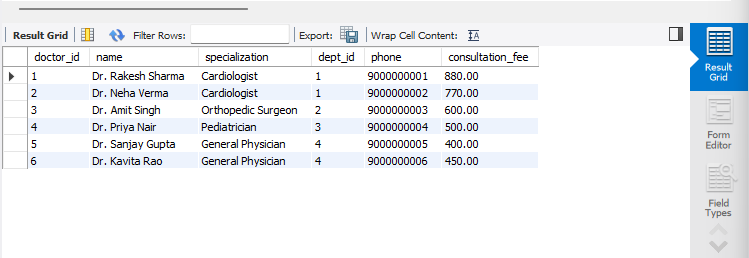
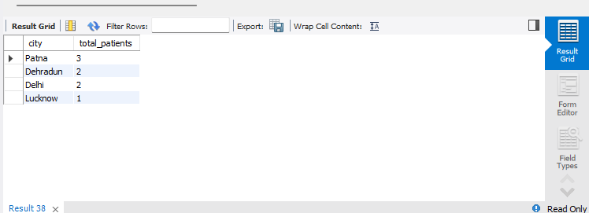
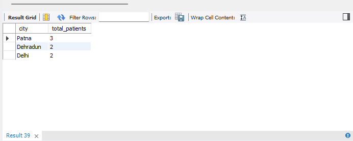
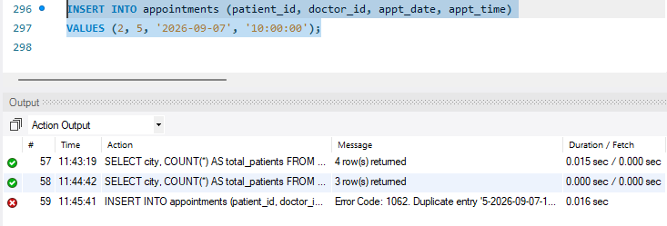

# Hospital Management System (MySQL)

A relational database for managing hospital appointments, doctors, patients, billing and medical records. Built to practice core SQL: table design, keys, constraints, and data analysis queries.

## Tech Stack
- MySQL 8.0
- MySQL Workbench (ER diagram)

## ER Diagram


## Database Schema

| Table | Description | Keys |
|---|---|---|
| `departments` | Hospital departments | PK: `dept_id` |
| `doctors` | Doctor details and consultation fee | PK: `doctor_id`, FK: `dept_id` |
| `patients` | Patient details | PK: `patient_id` |
| `appointments` | Patient-doctor bookings | PK: `appt_id`, FK: `patient_id`, `doctor_id` |
| `billing` | Bill for each appointment | PK: `bill_id`, FK: `appt_id` |
| `medical_records` | Diagnosis and prescription | PK: `record_id`, FK: `appt_id` |

## SQL Concepts Used

| Concept | Where |
|---|---|
| CREATE TABLE, INSERT, UPDATE | Table setup, sample data, status/fee/phone updates |
| PRIMARY KEY, FOREIGN KEY | All 6 tables, named constraints |
| CONSTRAINTS | `UNIQUE`, `CHECK`, `NOT NULL`, `DEFAULT` |
| SELECT, WHERE | Filtering doctors, patients, appointments |
| Operators | Comparison, `AND/OR/NOT`, `BETWEEN`, `IN`, `LIKE`, `IS NULL`, arithmetic |
| ORDER BY, LIMIT | Top-N results, latest appointments, pagination |
| GROUP BY | Appointments per doctor, patients per city, revenue by payment status |
| HAVING | Filtering grouped results (e.g. cities with 2+ patients) |

## Data Integrity Highlights
- `UNIQUE (doctor_id, appt_date, appt_time)` prevents double-booking a doctor.
- `CHECK (consultation_fee > 0)` blocks invalid fees.
- `CHECK (payment_status = 'Pending' OR payment_date IS NOT NULL)` ensures every paid bill has a payment date.
- Foreign keys block orphan records (e.g. appointment with a non-existent doctor).

## How to Run
1. Install MySQL 8.0.16 or later and MySQL Workbench.
2. Open Workbench and connect to your local server.
3. Open `hospital_db.sql` (File > Open SQL Script).
4. Run the full script (Ctrl + Shift + Enter).

## Sample Queries

**Top 3 highest consultation fees**
```sql
SELECT name, consultation_fee
FROM doctors
ORDER BY consultation_fee DESC
LIMIT 3;
```

**Revenue by payment status**
```sql
SELECT payment_status, COUNT(*) AS total_bills, SUM(amount) AS total_amount
FROM billing
GROUP BY payment_status;
```

**Patients with 2 or more completed/scheduled visits**
```sql
SELECT patient_id, COUNT(*) AS visits
FROM appointments
WHERE status != 'Cancelled'
GROUP BY patient_id
HAVING COUNT(*) >= 2
ORDER BY visits DESC
LIMIT 5;
```

## Screenshots

**1. Doctors table (after UPDATE: Cardiology fees increased by 10%)**
```sql
SELECT * FROM doctors;
```


**2. GROUP BY: patients per city**
```sql
SELECT city, COUNT(*) AS total_patients FROM patients GROUP BY city;
```


**3. HAVING: cities with 2 or more patients**
```sql
SELECT city, COUNT(*) AS total_patients FROM patients GROUP BY city HAVING COUNT(*) >= 2;
```


**4. Constraint in action: double booking blocked by `uq_doctor_slot`**
```sql
INSERT INTO appointments (patient_id, doctor_id, appt_date, appt_time)
VALUES (2, 5, '2026-09-07', '10:00:00');
```


## Future Improvements
- JOIN queries (appointments with doctor and patient names)
- Views for doctor schedule and pending bills
- Stored procedures and triggers for booking and billing automation
- Indexing with `EXPLAIN` performance comparison

## Author
Abhishek | B.Tech CSE (Cloud Computing), UPES Dehradun
